# Gallery

What the styling options look like. Every image is real `bar preview` output for the config shown under it (sample data, `bar render` with seeded history for sparklines), drawn with Hack Nerd Font Mono on a dark background. Regenerate with `make gallery`; `make check` fails when these files are stale. Options: [Configuration](config.md).

## Skins

`set skin` picks how segments are drawn. Powerline and capsule glyphs need a Nerd Font in the terminal. See [Skins](config.md#skins).

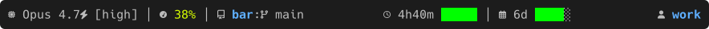

`COLUMNS=100 bar preview --state early` with:

```text
set palette default
set icons nerdfont
set left "#{model}#{effort} │ #{ctx} │ #{repo}:#{branch}"
set center "#{usage[type=5h]} │ #{usage[type=7d]}"
set right "#{account}"
```

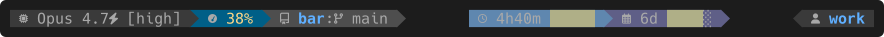

`COLUMNS=100 bar preview --state early` with:

```text
set skin powerline
set palette nord
set icons nerdfont
set left "#{model}#{effort} │ #{ctx} │ #{repo}:#{branch}"
set center "#{usage[type=5h]} │ #{usage[type=7d]}"
set right "#{account}"
```

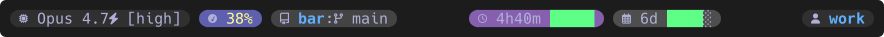

`COLUMNS=100 bar preview --state early` with:

```text
set skin capsule
set palette dracula
set icons nerdfont
set left "#{model}#{effort} │ #{ctx} │ #{repo}:#{branch}"
set center "#{usage[type=5h]} │ #{usage[type=7d]}"
set right "#{account}"
```

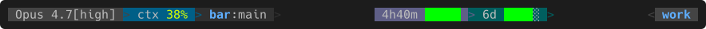

`COLUMNS=100 bar preview --state early` with:

```text
set skin powerline
set skin-glyphs ascii
set left "#{model}#{effort} │ #{ctx} │ #{repo}:#{branch}"
set center "#{usage[type=5h]} │ #{usage[type=7d]}"
set right "#{account}"
```

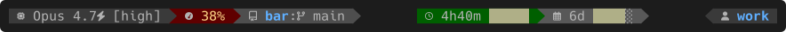

`COLUMNS=100 bar preview --state early` with:

```text
set skin powerline
set palette nord
set icons nerdfont
set left "#{model}#{effort} │ #{ctx[bg=52]} │ #{repo}:#{branch}"
set center "#{usage[type=5h,bg=22]} │ #{usage[type=7d]}"
set right "#{account}"
```

## Palettes

`set palette` swaps muted text, state colours, the usage ramp and the skin backgrounds; here on the powerline skin in the `burning` state. `terminal` uses the terminal's own 16 colours, drawn here with the xterm defaults. See [Palettes](config.md#palettes).

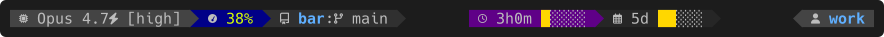

`COLUMNS=100 bar preview --state burning` with:

```text
set skin powerline
set palette default
set icons nerdfont
set left "#{model}#{effort} │ #{ctx} │ #{repo}:#{branch}"
set center "#{usage[type=5h]} │ #{usage[type=7d]}"
set right "#{account}"
```

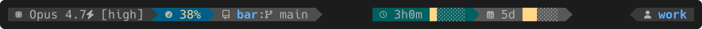

`COLUMNS=100 bar preview --state burning` with:

```text
set skin powerline
set palette nord
set icons nerdfont
set left "#{model}#{effort} │ #{ctx} │ #{repo}:#{branch}"
set center "#{usage[type=5h]} │ #{usage[type=7d]}"
set right "#{account}"
```

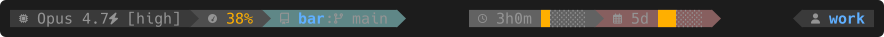

`COLUMNS=100 bar preview --state burning` with:

```text
set skin powerline
set palette gruvbox
set icons nerdfont
set left "#{model}#{effort} │ #{ctx} │ #{repo}:#{branch}"
set center "#{usage[type=5h]} │ #{usage[type=7d]}"
set right "#{account}"
```

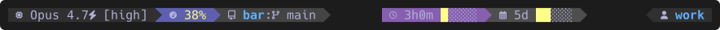

`COLUMNS=100 bar preview --state burning` with:

```text
set skin powerline
set palette dracula
set icons nerdfont
set left "#{model}#{effort} │ #{ctx} │ #{repo}:#{branch}"
set center "#{usage[type=5h]} │ #{usage[type=7d]}"
set right "#{account}"
```

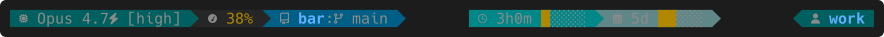

`COLUMNS=100 bar preview --state burning` with:

```text
set skin powerline
set palette solarized
set icons nerdfont
set left "#{model}#{effort} │ #{ctx} │ #{repo}:#{branch}"
set center "#{usage[type=5h]} │ #{usage[type=7d]}"
set right "#{account}"
```

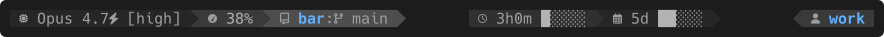

`COLUMNS=100 bar preview --state burning` with:

```text
set skin powerline
set palette mono
set icons nerdfont
set left "#{model}#{effort} │ #{ctx} │ #{repo}:#{branch}"
set center "#{usage[type=5h]} │ #{usage[type=7d]}"
set right "#{account}"
```

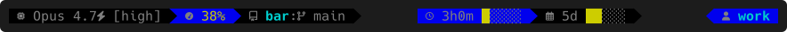

`COLUMNS=100 bar preview --state burning` with:

```text
set skin powerline
set palette terminal
set icons nerdfont
set left "#{model}#{effort} │ #{ctx} │ #{repo}:#{branch}"
set center "#{usage[type=5h]} │ #{usage[type=7d]}"
set right "#{account}"
```

## Bar glyphs

`glyphs=` on `usage` picks the cells of the bar; 10 cells wide here, `burning` state (25% and 30% left), so `eighths` shows its partial last cell.

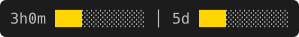

`COLUMNS=60 bar preview --state burning` with:

```text
set palette default
set left "#{usage[type=5h,glyphs=blocks,width=10]} │ #{usage[type=7d,glyphs=blocks,width=10]}"
```

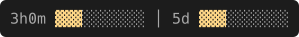

`COLUMNS=60 bar preview --state burning` with:

```text
set palette nord
set left "#{usage[type=5h,glyphs=shades,width=10]} │ #{usage[type=7d,glyphs=shades,width=10]}"
```

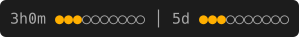

`COLUMNS=60 bar preview --state burning` with:

```text
set palette gruvbox
set left "#{usage[type=5h,glyphs=dots,width=10]} │ #{usage[type=7d,glyphs=dots,width=10]}"
```

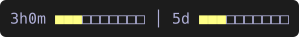

`COLUMNS=60 bar preview --state burning` with:

```text
set palette dracula
set left "#{usage[type=5h,glyphs=squares,width=10]} │ #{usage[type=7d,glyphs=squares,width=10]}"
```

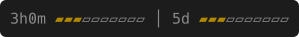

`COLUMNS=60 bar preview --state burning` with:

```text
set palette solarized
set left "#{usage[type=5h,glyphs=bars,width=10]} │ #{usage[type=7d,glyphs=bars,width=10]}"
```

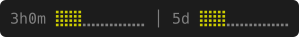

`COLUMNS=60 bar preview --state burning` with:

```text
set palette terminal
set left "#{usage[type=5h,glyphs=braille,width=10]} │ #{usage[type=7d,glyphs=braille,width=10]}"
```

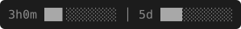

`COLUMNS=60 bar preview --state burning` with:

```text
set palette mono
set left "#{usage[type=5h,glyphs=eighths,width=10]} │ #{usage[type=7d,glyphs=eighths,width=10]}"
```

## Solid and gradient bars

`color=solid` (default) paints every filled cell in the colour of the current value; `color=gradient` runs the filled cells along the ramp. Both on the default palette, whose ramp has eleven steps.

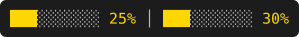

`COLUMNS=60 bar preview --state burning` with:

```text
set palette default
set left "#{usage[type=5h,color=solid,width=10,show=bar,pct]} │ #{usage[type=7d,color=solid,width=10,show=bar,pct]}"
```

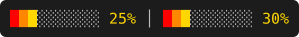

`COLUMNS=60 bar preview --state burning` with:

```text
set palette default
set left "#{usage[type=5h,color=gradient,width=10,show=bar,pct]} │ #{usage[type=7d,color=gradient,width=10,show=bar,pct]}"
```

## Projections and count

`eta` projects the time until the budget runs out at the burn so far (`→ok` when it lasts), `proj` the used percent at reset; `count=used` fills the bar and percentage with what is used. `burning` state. See [usage](config.md#usage).

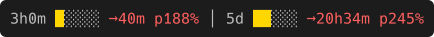

`COLUMNS=80 bar preview --state burning` with:

```text
set palette default
set left "#{usage[type=5h,show=time,bar,eta,proj]} │ #{usage[type=7d,show=time,bar,eta,proj]}"
```

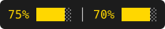

`COLUMNS=60 bar preview --state burning` with:

```text
set palette default
set left "#{usage[type=5h,count=used,show=pct,bar]} │ #{usage[type=7d,count=used,show=pct,bar]}"
```

## Spark and gauge

`spark` draws the used percent of the last samples, `gauge` one cell for the current value. `bar preview` keeps no history, so these come from `bar render` with a sample session (5-hour window 90% used, weekly 60%) and five seeded history samples per window (15, 35, 55, 75, 90 and 10, 20, 30, 45, 60 percent used).

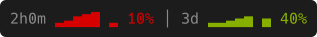

`COLUMNS=60 bar render` with:

```text
set palette solarized
set left "#{usage[type=5h,show=time,spark,gauge,pct]} │ #{usage[type=7d,show=time,spark,gauge,pct]}"
```

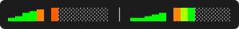

`COLUMNS=60 bar render` with:

```text
set palette default
set left "#{usage[type=5h,show=spark,bar,color=gradient,width=8]} │ #{usage[type=7d,show=spark,bar,color=gradient,width=8]}"
```

## Pace states

`bar preview --state` picks the sample usage; the colour follows the pace score, flipped in the final stretch.

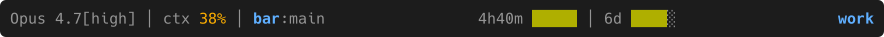

`COLUMNS=100 bar preview --state early` with:

```text
set palette gruvbox
set left "#{model}#{effort} │ #{ctx} │ #{repo}:#{branch}"
set center "#{usage[type=5h]} │ #{usage[type=7d]}"
set right "#{account}"
```

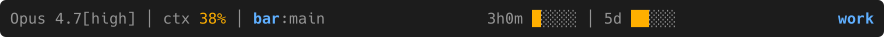

`COLUMNS=100 bar preview --state burning` with:

```text
set palette gruvbox
set left "#{model}#{effort} │ #{ctx} │ #{repo}:#{branch}"
set center "#{usage[type=5h]} │ #{usage[type=7d]}"
set right "#{account}"
```

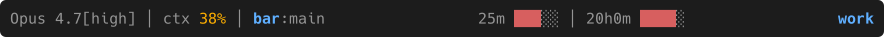

`COLUMNS=100 bar preview --state final` with:

```text
set palette gruvbox
set left "#{model}#{effort} │ #{ctx} │ #{repo}:#{branch}"
set center "#{usage[type=5h]} │ #{usage[type=7d]}"
set right "#{account}"
```

## Icons

`set icons nerdfont` adds a muted glyph before each segment, replacing the text label where there is one. `set icons emoji` draws emoji instead; their look depends on the viewer's emoji font, so it is shown as text below. See [Icons](config.md#icons).

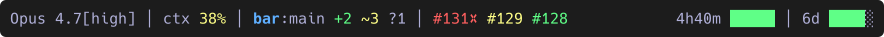

`COLUMNS=100 bar preview --state early` with:

```text
set palette dracula
set icons none
set left "#{model}#{effort} │ #{ctx} │ #{repo}:#{branch} #{dirty} │ #{prs[limit=3]}"
set right "#{usage[type=5h]} │ #{usage[type=7d]}"
```

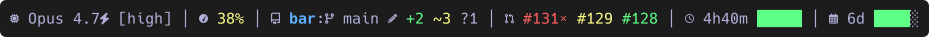

`COLUMNS=100 bar preview --state early` with:

```text
set palette dracula
set icons nerdfont
set left "#{model}#{effort} │ #{ctx} │ #{repo}:#{branch} #{dirty} │ #{prs[limit=3]}"
set right "#{usage[type=5h]} │ #{usage[type=7d]}"
```

`set icons emoji`, as text, colour stripped:

```text
🤖 Opus 4.7⚡ [high] │ 🧠 38% │ 📁 bar:🌿 main ✏️ +2 ~3 ?1 │ 🔀 #131❌ #129 #128 │ ⏳ 4h40m █████ │ 📅 6d ████░
```

`COLUMNS=100 bar preview` with:

```text
set icons emoji
set left "#{model}#{effort} │ #{ctx} │ #{repo}:#{branch} #{dirty} │ #{prs[limit=3]}"
set right "#{usage[type=5h]} │ #{usage[type=7d]}"
```

## Lines

`set left@2` and friends add lines, up to 64. The `two-line` preset puts session and git on line 1 and usage below. `set wrap on` flows a line too long for `COLUMNS` onto more rows instead. See [Lines and wrapping](config.md#lines-and-wrapping).

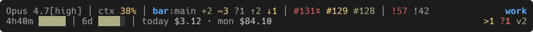

`COLUMNS=100 bar preview --state early` with:

```text
set left "#{model}#{effort} │ #{ctx} │ #{repo}:#{branch} #{dirty} #{ahead} │ #{prs[limit=3,author=@me]} │ #{issues[limit=3,assignee=@me]}"
set right "#{account}"
set left@2 "#{usage[type=5h]} │ #{usage[type=7d]} │ #{spendhist}"
set right@2 "#{sessions}"
set palette nord
```

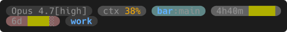

`COLUMNS=60 bar preview --state early` with:

```text
set skin capsule
set palette gruvbox
set wrap on
set left "#{model}#{effort} │ #{ctx} │ #{repo}:#{branch}"
set center "#{usage[type=5h]} │ #{usage[type=7d]}"
set right "#{account}"
```

## PR checks

`checks=` on `prs` marks CI state after each number: #131 failing, #129 pending, #128 passing. The default marks failures only. See [PR checks](config.md#pr-checks).

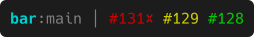

`COLUMNS=40 bar preview --state early` with:

```text
set palette terminal
set left "#{repo}:#{branch} │ #{prs}"
```

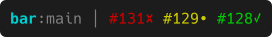

`COLUMNS=40 bar preview --state early` with:

```text
set palette terminal
set left "#{repo}:#{branch} │ #{prs[checks=fail,pending,pass]}"
```

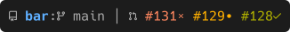

`COLUMNS=40 bar preview --state early` with:

```text
set palette gruvbox
set icons nerdfont
set left "#{repo}:#{branch} │ #{prs[checks=fail,pending,pass]}"
```
